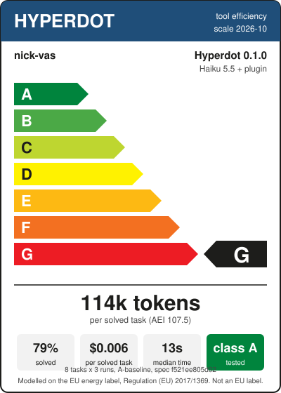

# Product information sheet: Hyperdot 0.1.0, tool efficiency, claude-haiku-5-5 with the plugin

| | |
|---|---|
| Supplier, product, version | nick-vas, Hyperdot, 0.1.0 |
| Model, plugin | claude-haiku-5-5, loaded |
| Scale | 2026-10 ([method](../label.md)) |
| Standard programme | A-baseline, 8 tasks of `benchmark/token-benchmark.json` (sha256 f521ee805d02), 24 sessions |
| Tool efficiency class | **G** |
| Agent Efficiency Index | 107.5 |
| Tokens per solved task | 113,548 |
| Answers that pass | 79.2% |
| Cost per solved task | $0.0058 (Claude Code's figure) |
| Median session time | 13 s |
| Coverage class | **A** (index 97.2: functions 93.5%, error codes 98.2%, commands 100%) |
| Runs | 20261023-091349 (2.1.309 (Claude Code)) |
| Note | adversarial review: 62 findings, 59 fixed with regression tests |

| Task | Tokens per solved task | Standard |
|---|---:|---:|
| COMP-PS-001 | 295,315 | 256,000 |
| COMP-GD-001 | 88,592 | 73,000 |
| CODE-PS-001 | 43,606 | 48,000 |
| CODE-PS-002 | 95,501 | 86,000 |
| DEBUG-PS-001 | 134,260 | 116,000 |
| DEBUG-GD-001 | 271,994 | 93,000 |
| CI-PS-001 | 52,374 | 56,000 |
| CI-PS-003 | 26,369 | 66,000 |
