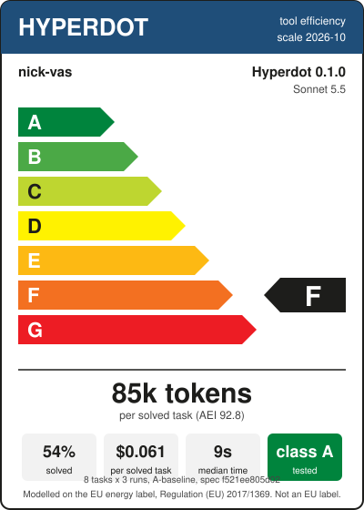

# Product information sheet: Hyperdot 0.1.0, tool efficiency, claude-sonnet-5-5

| | |
|---|---|
| Supplier, product, version | nick-vas, Hyperdot, 0.1.0 |
| Model, plugin | claude-sonnet-5-5, not loaded |
| Scale | 2026-10 ([method](../label.md)) |
| Standard programme | A-baseline, 8 tasks of `benchmark/token-benchmark.json` (sha256 f521ee805d02), 24 sessions |
| Tool efficiency class | **F** |
| Agent Efficiency Index | 92.8 |
| Tokens per solved task | 84,763 |
| Answers that pass | 54.2% |
| Cost per solved task | $0.0607 (Claude Code's figure) |
| Median session time | 9.2 s |
| Coverage class | **A** (index 97.2: functions 93.5%, error codes 98.2%, commands 100%) |
| Runs | 20261023-091333 (2.1.309 (Claude Code)) |
| Note | adversarial review: 62 findings, 59 fixed with regression tests |

| Task | Tokens per solved task | Standard |
|---|---:|---:|
| COMP-PS-001 | 658,740 | 256,000 |
| COMP-GD-001 | 61,605 | 73,000 |
| CODE-PS-001 | 20,094 | 48,000 |
| CODE-PS-002 | 68,899 | 86,000 |
| DEBUG-PS-001 | 141,935 | 116,000 |
| DEBUG-GD-001 | 59,629 | 93,000 |
| CI-PS-001 | 59,083 | 56,000 |
| CI-PS-003 | 60,104 | 66,000 |

Other profiles (informative, not rated):

| Profile | AEI | Pass | Tokens per solved task | Cost per solved task |
|---|---:|---:|---:|---:|
| B-scoped | 124.1 | 45.8% | 100,536 | $0.0847 |
| C-iterative | 167.8 | 66.7% | 133,253 | $0.1713 |
